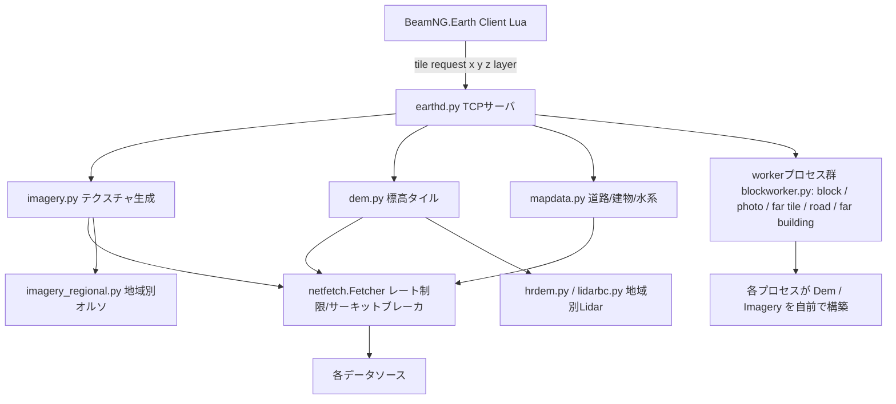

# BeamNG.Earth Japan Provider Extension - Implementation Plan v1.3 (EJ_PLAN)

> EJ_PLAN_0.md のレビュー結果と、プロジェクト実コード（`server/`）を参照した改善版実装計画。
> **EJ_PLAN_0.md は本ファイルに統合され削除された**（EJ_PLAN_0 のコンセプト・フェーズ・検証項目はすべて本ファイルに反映済み。検証地は宗像周辺 → 福岡市に変更）。
> 調査日: 2026-10-29 / 対象コード: protocol 4 (earthd.py), imagery.py, dem.py, netfetch.py, buildings.py, mapdata.py
> v1.1 更新: 検証地を変更 / プラグイン方式の実現可能性を追加
> v1.2 更新 (2026-11-04): main の 1.8.0-beta (`239e5f5d`) マージ後の影響を反映 — マルチプロセス化によるプラグイン登録の要件変更 (§2.4) / netfetch ポリシーの自動導出 (§2.3, Phase 2) / 地形ラティス 2 m → 1 m (§3.2, Phase 1) / 3dmr ベイク機構の追加 (§3.3, Phase 3) / `Source` の frozen dataclass 化 (Phase 0)
> **v1.3 更新 (2026-11-10): main の 1.9.1-beta (`e1c72abf`) マージ後の再調査を反映**
> - **add-ons 機能 (1.9.0-beta) の調査**: ゲーム MOD / コンパニオンプログラムの GitHub からのインストール・管理であり、**サーバー側のデータソース拡張（plugin.py 機能）とは目的が異なる**。plugin.py 機能を add-ons に寄せるのは不適切（§2.4）
> - **ポルトガル独自オルソ (`pt_dgt2021`/`pt_dgt2018`) の実装パターン**: プラグイン機構なしで `imagery_regional.REGIONAL` への**データソース追加**として実装済み。日本も同様のパターンで実現可能（§2.3, §2.4）
> - **GSI タイルの座標系を実測で確定**: seamlessphoto は **Web Mercator (EPSG:3857) の XYZ タイル**。v1.2 の「EPSG:4326 等間隔分割」は**誤り**。既存の japan エントリは正しく動作している（§3.1）
> - **GSI 標高タイルのサービス刷新**: 旧 `dem5a`/`dem5b`/`dem10b` の PNG は **2025-03-31 で廃止**。新 `dem1a_png`/`dem5a_png`/`dem5b_png`/`dem5c_png`/`dem_png` に移行。**デコード式も符号付き 24bit に変更**（§3.2）
> - **実装計画の簡素化**: プラグイン方式（plugin.py + tile_transform + gsi_tiles.py）は**不要**。データソース追加方式（`imagery_regional.REGIONAL` + dem.py の地域フック）に変更（§4）

---

## 1. レビューサマリ（EJ_PLAN_0 の重大な問題点）

EJ_PLAN_0.md はコンセプトとして正しい方向性だが、**プロジェクトの実コードを参照していない**ため、以下の問題を含む。

| # | EJ_PLAN_0 の記述 | 問題点 | 根拠（実コード / 実測） |
|---|---|---|---|
| A | Phase 2「GSI シームレス写真プロバイダーを新規実装」 | **既に実装済み**。座標系も正しい（下記 B 参照） | [`imagery_regional.py`](server/imagery_regional.py:121) の `"japan"` エントリ、[`credits.py`](server/credits.py:92) の `img:japan` |
| B | GSI タイルを Web Mercator の XYZ として扱う | **誤り（v1.2 の主張を撤回）**。GSI タイルは **Web Mercator (EPSG:3857) そのもの**。実測で確定: seamlessphoto z16 で Web Mercator 座標は 25/25 が 200、EPSG:4326 座標は 0/25（[`EJapan/probes/gsi_bruteforce.py`](EJapan/probes/gsi_bruteforce.py:1)）。既存の japan エントリは正しく動作 | [`imagery_regional.py`](server/imagery_regional.py:121) の japan エントリ（xyz タイプ） |
| C | 標高デコード式 `(R*65536 + G*256 + B) * 0.01 - 10000` | **誤り（新仕様に更新）**。現行の GSI 標高タイル PNG は**符号付き 24bit エンコード**: `x = 2^16*R + 2^8*G + B`、`x < 2^23` なら `h = x*0.01`、`x > 2^23` なら `h = (x - 2^24)*0.01`、`x = 2^23` は NA。無効値は `(128, 0, 0)` | GSI「標高タイルの詳細仕様」([`EJapan/probes/gsi_dem_spec4_out.txt`](EJapan/probes/gsi_dem_spec4_out.txt:65)) |
| D | BBox `LAT: 24.0~46.0, LON: 122.0~154.0` | **広すぎる**。実際の日本の範囲は `(24.0, 122.9, 45.6, 146.0)` | [`imagery_regional.py`](server/imagery_regional.py:121) の japan BBox |
| E | Phase 2「SQLite ベースのローカルキャッシュ」 | **不要**。プロジェクトは既に `cache.py` のディスクキャッシュ + netfetch の 404 マーカー + メモリ LRU を持つ | [`dem.py`](server/dem.py:208) の `Dem` クラス、[`netfetch.py`](server/netfetch.py:260) |
| F | Phase 3「PLATEAU をサーバーが動的配信」 | 現行アーキテクチャは**オフライン前処理 + 既存レイヤーへの注入**が適切。動的配信は設計思想（deterministic generation）に反する | [`buildings.py`](server/buildings.py:447) の `plan()`、[`mapdata.py`](server/mapdata.py:106) の `VECTOR_LAYERS` |
| G | 「Japan Router / Dispatcher」の新設 | 不要。プロジェクトは**データソースの差し替え**（チェーン/フォールバック）で地域対応する設計 | [`imagery.py`](server/imagery.py:165) の `BASE_CHAIN`、[`dem.py`](server/dem.py:217) の `register_chain` |

---

## 2. プロジェクトの現行アーキテクチャ（調査結果）

### 2.1 全体像



### 2.2 重要な設計原則（ROADMAP.md より）

- **Improvements must generalise**: 場所固有のコードは禁止。ただし「データソースの選択」は地域ごとに許容される（`Per-region choices are allowed only for data sources`）。
- **Deterministic generation**: 生成結果は (位置, 入力データ, バージョン) の純関数。タイルキーやロード順に依存しない。
- **全レイヤーが Web Mercator (EPSG:3857) ベース**: [`mapcells.py`](server/mapcells.py:1) の z14 セル、imagery のタイル座標、dem のタイルグリッドすべて。

### 2.3 既存の地域対応パターン（日本拡張の参考）

| パターン | 実装例 | 適用 |
|---|---|---|
| 地域別オルソのチェーン追加 | [`imagery_regional.py`](server/imagery_regional.py:33) の `REGIONAL` dict → [`imagery.py`](server/imagery.py:189) で `Source` 化（xyz 系は `max_zoom=17, min_zoom=REGIONAL_XYZ_MIN_ZOOM=16`） | GSI シームレス写真（**Web Mercator なのでそのまま動作**） |
| 地域別オルソの WMS export 追加 | [`imagery_regional.py`](server/imagery_regional.py:77) の `pt_dgt2021`/`pt_dgt2018`（DGT ポルトガル、WMS export タイプ、`lazy=True`、z15 親を 1024px で取得） | ポルトガル独自オルソ（**プラグイン機構なしで実装済み**） |
| 地域別 Lidar の DEM へのフック | [`dem.py`](server/dem.py:264) の `_canada()` → `hrdem.py` / `lidarbc.py` | GSI 標高タイル（同様のフックを追加） |
| 地域別データの netfetch ポリシー | [`netfetch.py`](server/netfetch.py:291) の `_regional_policies()` が `REGIONAL` から**自動導出**（xyz: rate=6.0, burst=20, max_conc=4, daily_budget=20000, optional=True / export: rate=1.0, max_conc=1, daily_budget=4000） | GSI ホストのレート制限（追加設定不要） |
| 環境変数によるオプトイン | `BNE_HRDEM`, `BNE_LIDARBC`, `BNE_BCORTHO` 等（[`dem.py`](server/dem.py:71)） | プラグインの有効化 |
| worker プロセスごとの再構築 | [`blockworker.init`](server/blockworker.py:157) が各 spawn プロセスで [`Dem`](server/blockworker.py:56) / [`Imagery`](server/blockworker.py:1976) を新規構築（1.8.0-beta で far tile / 道路タイル / ブロックが全プロセス化） | 地域フックの到達範囲（2.4） |

### 2.4 add-ons とプラグイン方式の関係（1.9.1-beta マージ後の再評価）

**結論: plugin.py 機能を add-ons に寄せるべきではない。また、プラグイン方式自体も不要になった。**

#### add-ons 機能の実態（1.9.0-beta で追加）

add-ons は**サードパーティのゲーム MOD / コンパニオンプログラム**を GitHub からインストール・管理する仕組み（[`docs/ADDONS.md`](docs/ADDONS.md:1)、[`server/addons.py`](server/addons.py:1)）:

- **kind**: `beamng-mod`（ゲーム MOD zip）、`companion`（ゲーム横の Python プログラム）、`link`（ダウンロードのみ）
- **レジストリ**: `server/data/addons.json`（バンドル）+ オンライン（BeamNG.Earth-data repo の `addons.json`、[`addons.py`](server/addons.py:78)）
- **インストール**: GitHub releases から zip / py をダウンロードし、ゲームの mods フォルダ or `<data>/addons/<id>/` に配置
- **ゲーム側**: `addons.lua` が `core_modmanager` 経由でマウント・有効化・無効化・削除

これは**ゲーム MOD の配布・管理**が目的であり、**サーバー側のデータソース拡張（imagery / dem の差し替え）とは無関係**。add-ons のレジストリは GitHub リポジトリを指すもので、サーバーコードの拡張には使えない。`companion` 種別も「ゲームの横で動く別プログラム」であり、サーバー内のデータソースではない。

#### ポルトガル独自オルソが示す標準パターン

ポルトガル独自オルソ（`pt_dgt2021`/`pt_dgt2018`）は**プラグイン機構なしで**、[`imagery_regional.REGIONAL`](server/imagery_regional.py:77) へのデータソース追加だけで実装されている:

- WMS export タイプ（`DGT_WMS`、PNG + 不透明白背景）で `REGIONAL` に 2 エントリ追加
- `netfetch._regional_policies()` がホストのポリシーを自動導出（export: rate=1.0, max_conc=1, daily_budget=4000）
- `DEFAULT_CHAIN` に自動で組み込まれ、`pt_dgt2021` → `pt_dgt2018` → `spain` のフォールバック順
- テスト: [`test_portugal_imagery.py`](server/tests/test_portugal_imagery.py:1)

**これは EJ_PLAN_1 v1.2 の「プラグイン方式（earthd.py + blockworker.py にローダーを追加）」よりはるかにシンプルで、プロジェクトの標準パターン**。日本も同様に実現できる。

#### プラグイン方式が不要になった理由

v1.2 でプラグイン方式を提案した根拠は「GSI タイルは EPSG:4326 なので座標変換が必要 → オリジナルソースに `tile_transform` フックが必要」だった。しかし:

1. **GSI タイルは Web Mercator**（実測で確定、§3.1）→ 座標変換不要 → `tile_transform` フック不要
2. **GSI 標高タイルも Web Mercator**（実測で確定）→ 座標変換不要
3. 地域別データの追加は `imagery_regional.REGIONAL` / dem.py の地域フックで実現可能（ポルトガルの先例）

つまり、**オリジナルソースへの変更は「データソースの追加」だけで済み、プラグインローダー（earthd.py / blockworker.py のフック）は不要**。

#### 残る論点: dem.py への GSI 標高フック

GSI 標高（`dem5a_png`）は imagery と違い、`REGIONAL` のようなデータ駆動の仕組みがない。`hrdem.py` / `lidarbc.py` と同様に、dem.py の `_canada()` と並ぶ地域フック（`_japan()`）を追加する必要がある。これは「データソースの追加」であり、ROADMAP の「Per-region choices are allowed only for data sources」に合致する。プラグイン方式（モンキーパッチ）より、`hrdem.py` と同様の**モジュールとしての追加**がプロジェクトの流儀に合う。

---

## 3. 技術的課題の詳細

### 3.1 【撤回】GSI タイルの座標系 — Web Mercator 確定

**v1.2 の「GSI タイルは EPSG:4326 等間隔分割」は誤り。実測で Web Mercator (EPSG:3857) と確定した。**

実測結果（2026-11-10、[`EJapan/probes/gsi_bruteforce.py`](EJapan/probes/gsi_bruteforce.py:1)）:

```
seamlessphoto z16  x=58211  (window 5x5 = 25 tiles)
  WEB_MERCATOR  y= 25806  -> 25/25 are 200
  EPSG4326      y= 19776  ->  0/25 are 200
  VERDICT: WEB_MERCATOR
```

- 渋谷 (35.681236, 139.767125) の z16 で、Web Mercator 座標のタイルは 25/25 が 200（実画像）、EPSG:4326 座標は 0/25（すべて 404）
- z17 でも同様（Web Mercator が 200、EPSG:4326 が 404）
- 福岡 (33.5902, 130.4017) でも同様

**結論**: 既存の [`imagery_regional.py`](server/imagery_regional.py:121) の japan エントリ（xyz タイプ）は**正しく動作している**。座標変換（`tile_transform`）も `gsi_tiles.py` も不要。

### 3.2 GSI 標高タイルの仕様（2026年時点の現行サービス）

**旧 `dem5a`/`dem5b`/`dem10b` の PNG 形式は 2025-03-31 で廃止され、`*_png` 形式に移行した**（GSI タイル一覧ページで確認、[`EJapan/probes/gsi_dem_spec3_out.txt`](EJapan/probes/gsi_dem_spec3_out.txt:3)）。

| サービス | URL | メッシュ | ズーム |
|---|---|---|---|
| DEM1A | `https://cyberjapandata.gsi.go.jp/xyz/dem1a_png/{z}/{x}/{y}.png` | 1 m | 1〜17 |
| DEM5A | `https://cyberjapandata.gsi.go.jp/xyz/dem5a_png/{z}/{x}/{y}.png` | 5 m | 1〜15 |
| DEM5B | `https://cyberjapandata.gsi.go.jp/xyz/dem5b_png/{z}/{x}/{y}.png` | 5 m | 1〜15 |
| DEM5C | `https://cyberjapandata.gsi.go.jp/xyz/dem5c_png/{z}/{x}/{y}.png` | 5 m | 1〜15 |
| DEM10B | `https://cyberjapandata.gsi.go.jp/xyz/dem_png/{z}/{x}/{y}.png` | 10 m | 1〜14 |

- タイルサイズ: 256 px、**Web Mercator の XYZ タイル**（実測で確定）
- テキスト形式（`dem5a`/`dem5b`/`dem` の `.txt`）は**令和6年10月より更新停止**
- データソース: 基盤地図情報数値標高モデルを線形的に平滑化

**デコード式（符号付き 24bit、公式仕様）**:

```
x = 2^16*R + 2^8*G + B
x < 2^23  →  h = x * 0.01          # 正の標高 (0 〜 83886.07 m)
x = 2^23  →  NA（無効値）
x > 2^23  →  h = (x - 2^24) * 0.01  # 負の標高（海抜下）
無効値: (R, G, B) = (128, 0, 0)
```

**v1.2 の `(R*65536 + G*256 + B) * 0.01 - 10000` は誤り**。旧式は「-10000 オフセット」だが、新式は「2^23 をゼロ点とする符号付き 24bit」であり、正の標高はオフセットなしで `x * 0.01` になる。

**BeamNG.Earth 側の DEM グリッドとの差異**:
- BeamNG.Earth: Web Mercator, 512 px タイル, Terrarium エンコード
- GSI: Web Mercator, 256 px タイル, 符号付き 24bit RGB エンコード

→ **座標変換は不要**（両方 Web Mercator）。**リサンプリング（256→512 px）+ デコード**の 2 段階のみ。

**1.8 以降の注意**: 地形ラティスが 2 m から **1 m** に変わった（2026-11-01、[`heightmap.py`](server/heightmap.py:37): `SIZE=1024, SQUARE=1.0`。far field の近傍タイルは [`FAR_SQUARE = 2.0`](server/heightmap.py:39) のままだ）。dem の 512px グリッド上、GSI 5m メッシュは 35°N で z15 が ~2 m/px、z13 が ~8 m/px 相当になる。近傍地形は z16（`FINE_ZOOM`）で読むが GSI DEM5A は z15 までなので、dem.py が AWS の z16 にやるのと同様に **z15 親からのアップサンプル**が必要（1 m ラティスへの実効倍率は 2 m 時代より上がる。データ解像度自体は 5 m で頭打ちなので品質は変わらないが、per-tile のサンプル数・CPU・GSI へのリクエスト体感は増す）。

### 3.3 PLATEAU 統合の現実解

現行の [`buildings.py`](server/buildings.py:447) の `plan()` は Overture のフットプリント + 属性（`class`, `height`, `num_floors` 等）から建物を生成する。PLATEAU の CityGML は:
- 建物フットプリント（2D ポリゴン）
- 高さ情報（`measuredHeight`, `roofType` 等）
- を正確に持つ

**統合方法（推奨）**: オフライン前処理で CityGML → Overture 互換のフットプリント + 高さ属性に変換し、`mapdata.py` の buildings レイヤーに**高さ情報を注入**する。これにより:
- `plan()` の既存ロジック（屋根形状・窓・階数）をそのまま活用
- deterministic generation の原則を維持
- サーバー側の変更を最小化

**案 C（1.8 以降の新選択肢）**: 1.8.0-beta で追加された 3dmr.eu ベイク経路（[`threedmr.py`](server/threedmr.py:1)）を模す — geo-search で近くの 3D モデルを見つけ、GLB を `.cdae` + テクスチャにベイクして material を登録する仕組み。PLATEAU メッシュ（CityGML → glTF）も「オフラインでベイク → 静的アセットとして配布」できる。ただし PLATEAU は都市あたり数百万建物の規模で 3dmr のキュレーション済みセットとは桁違いなので、案 A / 案 B が本線であり、案 C はランドマーク限定に留める。

**注意**: PLATEAU は都市ごとにデータが分かれており、全国カバレッジではない。ROADMAP の「improvements must generalise」原則に照らし、**データソースとしての追加**（地域限定）は許容されるが、**建物生成ロジックの分岐**は避ける。

**注意（1.8）**: `buildings.plan()` は **road worker プロセス内で実行**されるようになった（[`blockworker.roads_tile`](server/blockworker.py:157)）。案 A を採る場合、マージした buildings レイヤーを worker 各自の `mapdata` インスタンス（[`blockworker.py`](server/blockworker.py:63) で各プロセスが新規構築）にどう通すかの設計が必要。

---

## 4. 改善版実装計画（データソース追加方式）

**v1.3 の方針変更**: プラグイン方式（plugin.py + tile_transform + gsi_tiles.py）を廃止し、**ポルトガルの先例に倣ったデータソース追加方式**に変更。オリジナルソースへの変更は「データソースの追加」のみで、プラグインローダーは不要。

### Phase 0: GSI シームレス写真のズーム調整（`imagery_regional.py` のみ）

- **対象**: [`imagery_regional.py`](server/imagery_regional.py:121) の japan エントリ
- **作業**:
  1. `max_zoom` を 17 → **18** へ（GSI シームレス写真は z18 まで提供。現行 xyz 地域ソースは `max_zoom=17` に統一されているので、`Source` 生成時に japan だけ 18 にするか、`REGIONAL` のエントリにズーム情報を追加する）
  2. `min_zoom` は `REGIONAL_XYZ_MIN_ZOOM (16)` のまま（far ring の z16 挙動との整合。z15 開始は他地域との整合を確認してから）
- **検証**: 福岡（33.59, 130.40）・東京で z16〜z18 の写真が正しい位置に表示されるか確認。**far ring（z16）とベース写真が worker プロセスでも正しくレンダリングされること**（1.8 以降は全 worker が自前の Imagery を持つが、`REGIONAL` はモジュール読み込み時に登録されるので全プロセスに届く）

### Phase 1: GSI 標高プロバイダー（`EJapan/gsidem.py` + dem.py の地域フック）

- **方針**: [`hrdem.py`](server/hrdem.py:108) の `Hrdem` クラスと同様の「dem.py のグリッドでタイルを返す」モジュールとして実装
- **作業**:
  1. `EJapan/gsidem.py` を新規作成
     - `GsiDem` クラス: `tile(z, x, y) -> (heights float32 [512, 512], valid bool [512, 512])`
     - 内部処理: Web Mercator タイル（**座標変換不要**）→ 256px タイル取得 → **符号付き 24bit デコード**（§3.2）→ 512px へリサンプリング
     - フォールバック: `dem5a_png` → `dem_png`（DEM10B）→ なし（Mapterhorn にフォールバック）
     - **ネットワークは必ず `netfetch.Fetcher` 経由**（AGENT.md §6: モジュール固有の `urllib` 呼び出し禁止。`hrdem.py` と同様に `__init__` で fetcher を受け取り、`register_chain` で GSI ホストを登録する）
  2. `dem.py` に地域プロバイダーフック `_japan()` を追加（`_canada()` と同様、デフォルト: 何もしない。`hrdem`/`lidarbc` と同様に `GsiDem` を `__init__` で生成）
  3. 日本 BBox 内のタイルのみ GSI を適用（`covers(z, x, y)` で判定）
     - ズーム: z13 以上で適用（35°N で z15 ~2 m/px、z13 ~8 m/px 相当。地形ラティスは 1.8 で 1 m に変わったが、GSI DEM5A は z15 までなので近傍の z16 は z15 親のアップサンプルで供給 — dem.py の AWS z16 扱いと同様）
  4. クレジット: `credits.py` に `dem:gsi` を追加
- **注意**: GSI 標高は**地形モデル（DTM）相当**（建物・樹木なし）。Mapterhorn の `ground_filter` と同様の扱いでよい。

### Phase 2: GSI シームレス写真の改善（Phase 0 の続き）

- **作業**:
  1. Phase 0 のズーム調整を確定（z18 の有効性を検証）
  2. `min_zoom` の調整: z15 開始も候補（GSI は z15 でも高解像度）だが、他地域との far ring 挙動（z16）との整合を確認
  3. netfetch ポリシー: **設定不要** — `_regional_policies()` が自動導出（xyz: rate=6.0, burst=20, max_conc=4, daily_budget=20000, optional=True）。ただしこの budget は **DEM5A と共有**されるので、写真 + 標高の 1 日合計が 2 万以内に収まることを確認（収まらない場合は `BNE_*` 等で DEM 側の適用ズームを絞る）
- **検証**: 福岡・東京の都市部で z16〜z18 の写真が正しく表示されるか（z15 は適用判断後）

### Phase 3: PLATEAU 3D 都市モデルのプリベイク（`EJapan/plateau_converter.py`）

- **方針**: オフライン前処理で CityGML → 軽量フットプリント + 高さ属性に変換
- **作業**:
  1. `EJapan/plateau_converter.py` を新規作成
     - 入力: PLATEAU CityGML（`bldg/*.gml`）
     - 出力: GeoJSON（フットプリント + `height`, `num_floors`, `roof_type` 属性）
     - 処理: GML パース（`xml.etree` または `lxml`）→ 座標変換（JGD2011 / 平面直角座標系 → WGS84）→ 建物抽出 → 簡略化
  2. 変換結果を `mapdata.py` の buildings レイヤーに統合する方法を設計
    - 案 A: Overture の buildings レイヤーに高さ情報をマージ（推奨。`plan()` が road worker プロセスで動く点に注意: worker 各自の mapdata に通す設計が必要）
    - 案 B: 別レイヤー `plateau_buildings` として追加（`OPTIONAL_LAYERS` 方式。`building_parts` / `places` が先例）
    - 案 C: 3dmr.eu ベイク経路（[`threedmr.py`](server/threedmr.py:1)）を模した静的アセット化 — ランドマーク限定（3.3 参照）
  3. 対象エリアの選定: **福岡市**（33.59, 130.40）から開始し、首都圏へ拡大
- **注意**: PLATEAU データは都市ごとにライセンス・更新時期が異なる。クレジット表示と利用規約の確認が必要。

### Phase 4: 検証とチューニング

- **作業**:
  1. **福岡市周辺**（33.59, 130.40）で標高の起伏（山と海面）が正しく描画されるか確認
  2. GSI 写真が正しい位置に表示されるか（Web Mercator なので座標変換の検証は不要。ズーム調整の検証のみ）
  3. サスペンション挙動とコリジョンの整合性テスト
  4. ベンチマーク: [`tools/benchmark.py`](tools/benchmark.py) に福岡のプレースを追加
  5. クレジット表示の確認（GSI, PLATEAU）

---

## 5. リスクと考慮事項

| リスク | 影響 | 対策 |
|---|---|---|
| GSI の利用規約（過剰リクエスト禁止） | アカウント停止・アクセス制限 | netfetch ポリシー（自動導出の `rate=6.0` 等）を厳守。キャッシュを活用 |
| GSI ホストの daily_budget 20000 が写真 + DEM 共用 | 初回訪問で `BudgetExceeded` が頻発 | 1 日合計を 2 万以内に抑える（両レイヤーが同一 budget）。prefetch / predownload（`Dem.predownload`, `prewarm.py`）で散らす |
| ~~GSI タイルの座標系変換ミス~~ | ~~画像・標高の位置ずれ~~ | **不要になった**（Web Mercator 確定、実測済み）。変換関数のテストも不要 |
| ~~プラグインが worker プロセスで効かない~~ | ~~主プロセスは正常だが far ring / 道路タイルだけグローバル画像・標高になる~~ | **不要になった**（プラグイン方式を廃止。`REGIONAL` はモジュール読み込み時に全プロセスへ登録される） |
| DEM のズーム整合 | 遠景と近景で標高が不連続 | Mapterhorn との境界でフェザリング（`hrdem.py` の `feather()` を流用） |
| PLATEAU データのライセンス | クレジット表示義務 | 都市ごとのライセンス確認とクレジット表示 |
| 日本国外での誤適用 | 世界の他地域が劣化 | BBox 判定を厳密に（`covers()` でタイル単位判定） |
| 標高デコードの nodata 誤判定 | 海岸線が海面に沈む/浮く | **新仕様の無効値 `(128, 0, 0)` と `x = 2^23` を正しく判定**し、`fill_holes()` で補間 |
| GSI 標高タイルのサービス変更 | URL が 404 になる | 旧 `dem5a` は廃止済み。`dem5a_png` → `dem_png` のフォールバック + 404 マーカーで Mapterhorn にフォールバック |

---

## 6. ファイル変更一覧（見積もり）

### オリジナルソースへの変更（データソース追加のみ）

| ファイル | 変更種別 | 内容 | 行数見積 |
|---|---|---|---|
| `server/imagery_regional.py` | 修正 | japan エントリの `max_zoom` を 18 へ（ズーム情報の追加） | ~2 行 |
| `server/dem.py` | 修正 | 地域プロバイダーフック `_japan()` 追加（`GsiDem` の遅延生成、`_canada()` と同様） | ~10 行 |
| `server/credits.py` | 修正 | `dem:gsi` クレジット追加 | ~1 行 |

### プラグイン側（`EJapan/` 新規）

| ファイル | 変更種別 | 内容 |
|---|---|---|
| `EJapan/gsidem.py` | 新規 | GSI 標高プロバイダー（`dem5a_png` → `dem_png` フォールバック、符号付き 24bit デコード） |
| `EJapan/plateau_converter.py` | 新規 | PLATEAU CityGML → GeoJSON 変換 |
| `EJapan/tests/` | 新規 | デコード・BBox・フォールバックのテスト |

### 不要になったもの（v1.2 から削除）

| ファイル | 理由 |
|---|---|
| `EJapan/plugin.py` | プラグイン方式を廃止（データソース追加方式に変更） |
| `EJapan/gsi_tiles.py` | 座標変換が不要（GSI は Web Mercator 確定） |
| `server/earthd.py` のプラグインローダー | プラグイン方式を廃止 |
| `server/blockworker.py` のプラグインローダー | プラグイン方式を廃止 |
| `server/imagery.py` の `tile_transform` フック | 座標変換が不要 |

---

## 7. 結論

EJ_PLAN_0.md のコンセプト（GSI 標高 + シームレス写真 + PLATEAU）は有効だが、**1.9.1-beta マージ後の再調査で以下の 3 点が確定した**:

1. **GSI タイルは Web Mercator (EPSG:3857)** — v1.2 の「EPSG:4326 等間隔分割」は誤り。実測で確定（seamlessphoto z16 で Web Mercator 座標 25/25 が 200、EPSG:4326 座標は 0/25）。**座標変換は不要**で、既存の japan エントリは正しく動作している
2. **GSI 標高タイルはサービス刷新済み** — 旧 `dem5a`/`dem5b`/`dem10b` の PNG は 2025-03-31 で廃止。新 `dem1a_png`/`dem5a_png`/`dem5b_png`/`dem5c_png`/`dem_png` に移行。**デコード式は符号付き 24bit**（`x = 2^16*R + 2^8*G + B`、`x < 2^23` なら `h = x*0.01`、`x > 2^23` なら `h = (x - 2^24)*0.01`、無効値 `(128, 0, 0)`）
3. **プラグイン方式は不要** — ポルトガル独自オルソ（`pt_dgt2021`/`pt_dgt2018`）が示す通り、地域別データは `imagery_regional.REGIONAL` への**データソース追加**で実現できる。add-ons 機能はゲーム MOD 管理であり、サーバーのデータソース拡張とは目的が異なるため、**plugin.py 機能を add-ons に寄せるのは不適切**

**実装方針**: プラグイン方式（plugin.py + tile_transform + gsi_tiles.py）を廃止し、**データソース追加方式**に変更。オリジナルソースへの変更は「`imagery_regional.py` の japan ズーム調整 + `dem.py` の `_japan()` フック + credits」のみで、プラグインローダーは不要。

実装フェーズは Phase 0（GSI 写真のズーム調整）→ Phase 1（GSI 標高 `dem5a_png`）→ Phase 2（GSI 写真改善）→ Phase 3（PLATEAU）→ Phase 4（検証）の順。まず Phase 0 から着手し、福岡で動作確認後に Phase 1 へ進むことを推奨する。